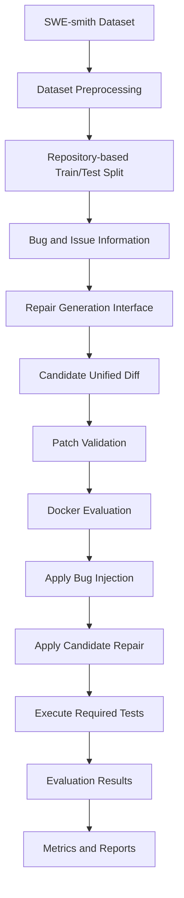

# SWE-Repair
## An AI-Based Framework for Automated Python Bug Detection and Code Repair

### Project Overview

SWE-Repair is a research prototype for automated repair of Python software bugs using repository-level context, code-generation models, patch validation, and automated testing.

The project uses a subset of the SWE-smith dataset to prepare bug-repair tasks and evaluate repair candidates in isolated Docker environments.

The proposed model is Qwen2.5-Coder-3B-Instruct with Low-Rank Adaptation (LoRA) fine-tuning.

**Research status:** Dataset preparation, Docker evaluation infrastructure, reference repair validation, and model adapter interface are implemented. Actual Qwen inference and LoRA fine-tuning remain pending.

---

## 1. Objectives

- Prepare repository-level Python repair tasks.
- Separate training and testing data by repository.
- Validate unified Git diff patches.
- Reproduce injected bugs in isolated environments.
- Generate candidate repair patches through a modular interface.
- Apply candidate patches and execute required tests.
- Measure repair correctness, execution time, and test outcomes.
- Provide a foundation for Qwen-based automated repair.

## 2. Proposed Technologies

| Component | Technology |
|---|---|
| Programming language | Python |
| Dataset | SWE-smith |
| Proposed model | Qwen2.5-Coder-3B-Instruct |
| Fine-tuning method | LoRA |
| Evaluation environment | Docker |
| Testing | pytest |
| Data processing | JSONL |
| Version control | Git |

## 3. System Architecture



## 4. Project Structure

```text
SWE-Repair/
|
|-- data/
|   |-- train.jsonl
|   |-- test.jsonl
|   |-- train_full.jsonl
|   |-- test_full.jsonl
|   |-- candidate_repair.patch
|
|-- src/
|   |-- buggy_examples.py
|   |-- repair_agent.py
|   |-- repair_pipeline.py
|   |-- model_config.py
|   |-- qwen_adapter.py
|   |-- patch_utils.py
|   |-- test_repair_components.py
|
|-- tests/
|   |-- test_repair.py
|
|-- results/
|   |-- benchmark_validation.json
|   |-- final_project_audit.json
|   |-- dataset_evaluation.json
|   |-- evaluation_results.json
|
|-- reports/
|   |-- experimental_results.md
|
|-- docs/
|   |-- architecture.md
|   |-- methodology.md
|   |-- experimental_setup.md
|   |-- limitations.md
|
|-- main.py
|-- evaluate_dataset.py
|-- evaluate_repair.py
|-- generate_repair.py
|-- finalize_experiment.py
|-- validate_patches.py
|-- README.md
```

## 5. Dataset Preparation

The project uses a pilot subset of SWE-smith.

The current prepared subset contains:

- 153 usable records.
- 118 training records.
- 35 testing records.
- 27 repositories.
- Repository-grouped train/test separation.
- No repository overlap between the two splits.

The dataset was filtered to remove unusable records and checked for basic unified diff structure.

The SWE-smith patch represents an injected bug change. It must not be mistaken for a gold repair patch.

## 6. Repair Pipeline

The repair pipeline consists of the following stages:

1. Load a repair task.
2. Read the issue description and required tests.
3. Prepare repository context.
4. Generate a candidate repair patch.
5. Validate patch structure.
6. Start the Docker evaluation environment.
7. Apply the dataset bug-injection patch.
8. Apply the candidate repair patch.
9. Execute the required tests.
10. Save evaluation results.

## 7. Evaluation Metrics

### Repair success rate

Number of successfully repaired tasks divided by the number of evaluated tasks.

### Test pass rate

Number of required tests passed divided by the total required tests executed.

### Pass@1

The fraction of tasks for which the model's first generated candidate successfully resolves the task.

### Execution time

Time required to execute the repair evaluation process.

### Memory usage

Peak memory consumption during model inference and repair evaluation.

Model-specific metrics must only be reported after actual model inference and benchmark execution.

## 8. Current Experimental Validation

A Docker experiment was conducted on a SWE-smith task.

- Clean repository baseline: 2 tests passed.
- After applying the injected bug patch: 2 tests failed.
- After applying an oracle inverse patch: 2 tests passed.

This demonstrates that the Docker evaluation infrastructure can reproduce the selected bug and verify a reference repair.

**Important:** The inverse patch is an oracle/reference repair, not an AI-generated repair. This experiment does not establish Qwen model accuracy.

## 9. Model Configuration

Proposed model:

`Qwen/Qwen2.5-Coder-3B-Instruct`

Proposed fine-tuning approach:

- Low-Rank Adaptation (LoRA).
- Supervised fine-tuning on appropriate repair examples.
- Repository-level issue and code context.
- Unified diff patch generation.
- Automated test-based evaluation.

Actual model inference and LoRA training have not yet been completed.

## 10. How to Run

Activate the virtual environment:

```powershell
.\venv\Scripts\Activate.ps1
```

Run the prototype:

```powershell
python main.py
```

Run the unit tests:

```powershell
python -m pytest .\tests -q
```

Run the adapter component tests:

```powershell
python -m unittest .\src\test_repair_components.py -v
```

Validate dataset patches:

```powershell
python validate_patches.py
```

Generate the experiment report:

```powershell
python finalize_experiment.py
```

## 11. Limitations

- The prepared dataset is a pilot subset, not the complete SWE-smith dataset.
- Actual Qwen inference is pending.
- LoRA training is pending.
- Model-generated benchmark Pass@1 is unavailable.
- The oracle inverse-patch experiment is not an AI repair result.
- Patch-format validation alone does not establish semantic correctness.
- Results from a single Docker task cannot establish general repair performance.

## 12. Future Work

- Run Qwen2.5-Coder inference on compatible compute.
- Prepare and validate model training examples.
- Fine-tune using LoRA.
- Evaluate on the held-out repository-disjoint test set.
- Compare the base and fine-tuned models.
- Increase dataset size.
- Report Pass@1, test pass rate, execution time, and memory usage.

## 13. Conclusion

SWE-Repair establishes a modular foundation for repository-level Python bug repair. The project includes a prepared SWE-smith pilot dataset, patch validation, Docker-based bug reproduction, an automated repair evaluator, reference repair validation, and a tested Qwen adapter interface.

The next research stage is actual model inference, LoRA fine-tuning, and held-out benchmark evaluation.
