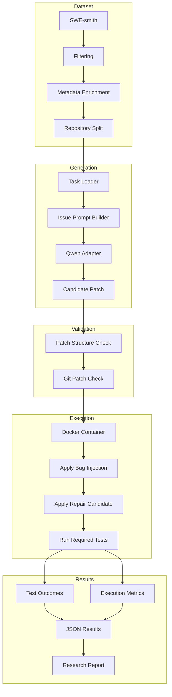

# SWE-Repair System Architecture

## Overview

SWE-Repair uses a modular architecture to separate dataset preparation, repair generation, patch validation, and isolated execution.

## Architecture

## Module Responsibilities

| Module | Responsibility |
|---|---|
| Dataset preparation | Filters and organizes repair tasks |
| Task loader | Retrieves task descriptions and test information |
| Prompt builder | Formats repair instructions |
| Qwen adapter | Provides the model generation interface |
| Patch utilities | Checks candidate diff structure |
| Docker evaluator | Applies patches in isolated containers |
| Test runner | Executes required tests |
| Result processor | Stores metrics and experiment outcomes |

## Data Flow

The dataset is first filtered and divided into repository-disjoint training and testing sets.

A repair task is loaded and its issue description is converted into a structured prompt. The proposed Qwen model generates a candidate patch.

The patch is checked before being passed to the Docker evaluator. The evaluator reproduces the injected bug, applies the candidate patch, and executes the required tests.

The test outcomes and execution information are saved as structured JSON results.
